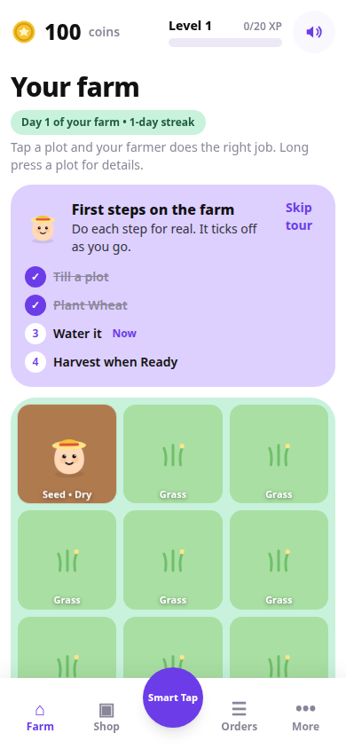

# ASMR Farmer Simulator — A cosy farm built for sound and touch

ASMR Farmer Simulator is a cosy top-down tile farming prototype built around satisfying taps. A blob farmer walks to the plot you tap, with a small action queue, or you work directly with the tool menu: till, seed, water, harvest, clear.

## What it does

- Six crops with staged, timed growth, a coin economy, a seed shop, and an orders board.
- Hens and cows that produce eggs and milk, a rain event that waters dry plots, levels, a farm journal, and a daily streak.
- Growth is timestamp based, and only one stage completes while you are away, which the game states honestly.
- Designed for sound and touch first: two sound styles, and a distinct haptic for every action.

## Status

Working prototype, built November 2026.

## Showcase only

This repository is a showcase. It contains no source code and no build files, and nothing here is open source. The screenshot(s) above are showcase images only. See NOTICE.md.

## Contact

Built by Yash Dashrath, Pune, India.

- Email: yashdashrath18@gmail.com
- LinkedIn: https://www.linkedin.com/in/yash-dashrath
- Yash MediaWorks: https://www.linkedin.com/company/yashmediaworks/
